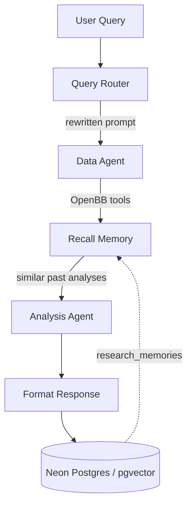

# Trading Assistant

An intelligent trading assistant built with LangChain, LangGraph and OpenBB. A LangGraph pipeline routes each question to the right OpenBB tool (Yahoo Finance, OECD), and an analysis agent turns the data into insights. Supports OpenAI, Gemini, Claude, Perplexity, OpenRouter and Ollama. Analyses, API snapshots, chat state and semantic memories are stored in Neon Postgres (pgvector).

## Features

- 🤖 **Multi-LLM Support**: Choose between OpenAI, Google Gemini, Anthropic Claude, Perplexity, OpenRouter, or Ollama
- 🧩 **Multi-Agent System**: Separate data retrieval from analysis for better performance and clarity
- 📊 **Real-time Market Data**: Access stock quotes, historical data, news, and company profiles via OpenBB Tools (using Yahoo Finance & OECD as two main sources)
- 📈 **Economic Indicators**: Fetch GDP, CPI, and other economic data
- 🧠 **Research Memory**: Past analyses are stored in pgvector and recalled as context for similar questions
- 💬 **Conversational Interface**: Natural language queries for financial data
- 🌟 **Commodity Mapping**: Automatic symbol resolution (Gold→XAU, Silver→XAG, etc.)

## Requirements

- [uv](https://docs.astral.sh/uv/) >= 0.13.4 (Python 3.12 is installed automatically)
- Node.js >= 26.12.1 (see `frontend/.nvmrc`)
- A [Neon](https://neon.tech) Postgres database
- An API key for at least one LLM provider (not needed for Ollama)

## Setup

```bash
git clone https://github.com/samarthiith/Trading-Assistant
cd Trading-Assistant
uv sync
cp credentials/.env.example credentials/.env
```

1. Edit `credentials/.env`: add your LLM API key(s) and `NEON_DATABASE_URL` (Neon connection string with `sslmode=require`). Optional: `APP_USER_ID` (defaults to `local`).
2. Edit `config.yaml`: choose `LLM_Model_provider` and the model names (and `OLLAMA_BASE_URL` if you use Ollama).
3. Create the tables and enable pgvector (safe to re-run):

```bash
uv run python -m backend.db.init_db
```

The LangGraph checkpoint tables are created automatically on first run. The embedding model downloads on first use, so no embedding API key is needed.

## Run

Run all commands from the repository root.

**Web app** (two terminals):

```bash
uv run uvicorn backend.api:app --reload      # API on :8000
```

```bash
cd frontend && npm install && npm run dev    # UI on http://localhost:5173
```

**CLI** (uses the provider set in `config.yaml`):

```bash
uv run python -m backend.agent_system
```

Example interaction with **Two-Agent System**: Separate data retrieval and analysis:

```bash
🤖 Initializing Agent System with gemini...
✅ Agent System ready!
   📡 Data Agent: Fetches market data
   📊 Analysis Agent: Provides insights

You: What's the gold price trend?
[Agent processes with two-phase approach: data → analysis]

You: Get me the latest news about Tesla
[Agent retrieves TSLA news then analyzes sentiment]
```

## How It Works



1. The query router adds hints to the question, such as commodity symbols (Gold → `XAU=F`, Oil → `CL=F`, …) and countries.
2. The data agent (an LLM with the OpenBB tools) fetches the data, guided by the rewritten prompt.
3. The recall memory step searches `research_memories` (pgvector cosine similarity) for the user's earlier analyses of similar questions, filtered by symbol when there is one. Up to 3 matches with similarity ≥ 0.5 are kept; if the search fails, the step is skipped.
4. The analysis agent (your chosen LLM) interprets the data, using the recalled analyses as dated background (the current data takes precedence). The response includes the analysis plus an expandable block with the raw tool output.
5. Conversation state is checkpointed per `session_id` (LangGraph thread).

Each run is saved to `analysis_runs` (`pending` / `completed` / `failed`) with its raw data in `api_snapshots`. Completed analyses are also embedded into `research_memories`, which the recall memory step searches on later questions. Database errors are logged and never block the answer. See [docs/MULTI-AGENT_SYSTEM.md](docs/MULTI-AGENT_SYSTEM.md) for details.

## Architecture

| Layer | Stack | Location |
| --- | --- | --- |
| UI | React 19 + Vite (proxies `/api` to `:8000`) | `frontend/` |
| API | FastAPI + Uvicorn | `backend/api.py` |
| CLI | Interactive terminal chat | `backend/agent_system.py` |
| Agents | LangGraph orchestrator, data agent, memory recall, analysis agent, query router, prompts | `skills/agents/`, `skills/utils/`, `skills/prompts/` |
| Market data | OpenBB (Yahoo Finance, OECD) | `skills/tools/openbb_tool.py` |
| Persistence | Neon Postgres via SQLAlchemy + psycopg 3, pgvector | `backend/db/` |
| Chat state | LangGraph `PostgresSaver` checkpointer (falls back to in-memory) | `backend/db/connection.py` |
| Embeddings | Local `fastembed` (`all-MiniLM-L6-v2`, 384-dim) | `backend/db/embeddings.py` |

```txt
backend/       FastAPI API, CLI entry point, Neon/Postgres layer (db/)
skills/        AI components: agents, OpenBB tools, query router, prompts
frontend/      React UI (Vite)
docs/          Architecture docs (also served in the UI)
credentials/   .env with API keys and database URL (gitignored)
config.yaml    LLM provider and model selection
```

### API

| Method | Path | Description |
| --- | --- | --- |
| GET | `/api/config` | Available providers and models, default provider, example questions |
| POST | `/api/chat` | `{message, session_id, provider}` → `{run_id, analysis, raw_data}` |
| GET | `/api/docs` | List the Markdown files in `docs/` |
| GET | `/api/docs/{doc_id}` | Content of one doc |

## License

AGPLv3
